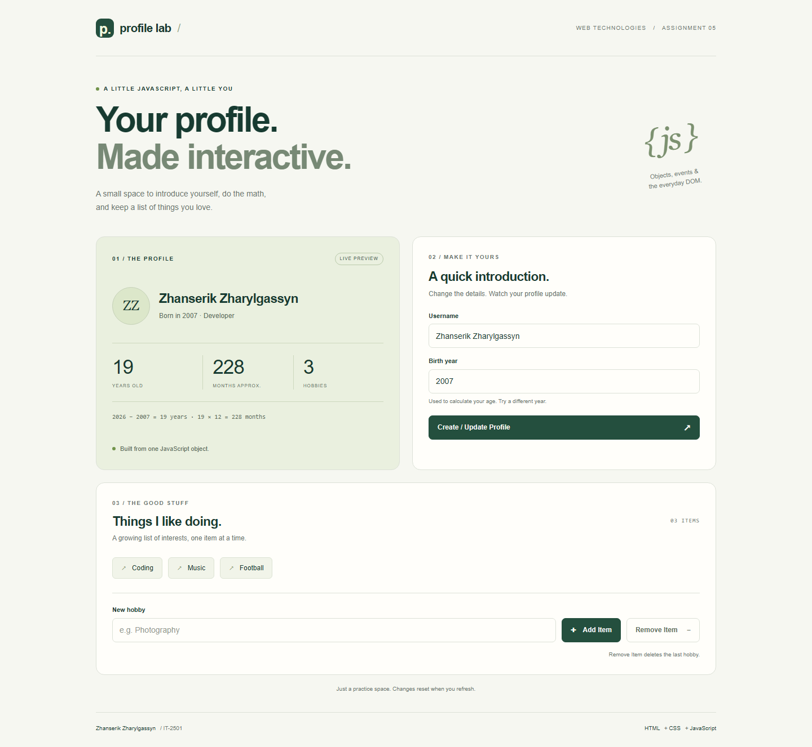
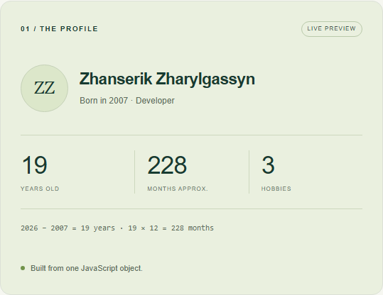
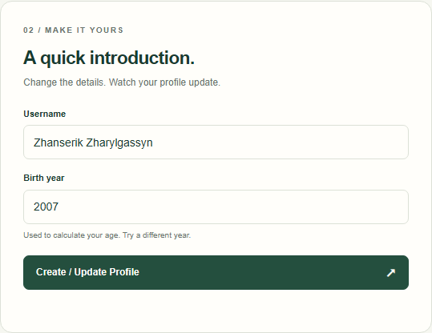
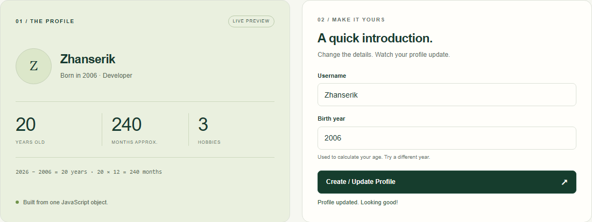
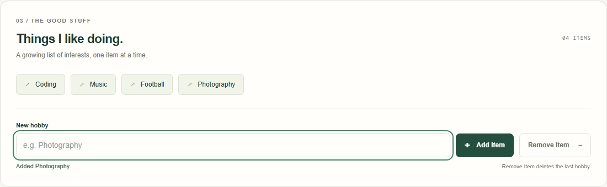
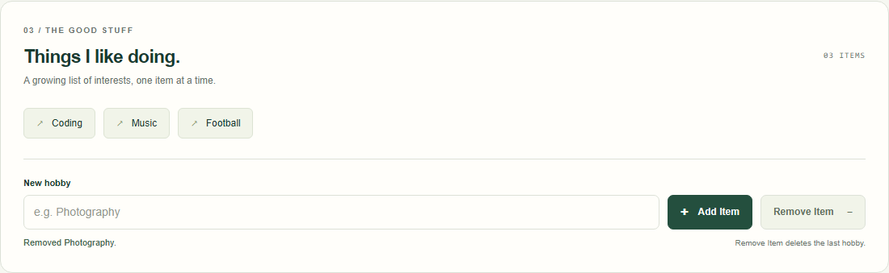
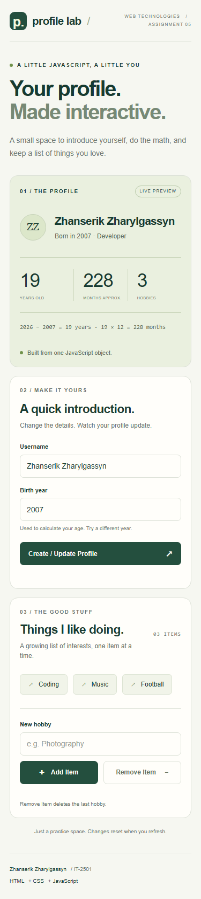

# Profile Lab — Assignment 5

**Name:** Zhanserik Zharylgassyn  
**Group:** IT-2501  
**Topic:** JavaScript Basics — DOM Manipulation & Events

A small profile editor built with plain HTML, CSS, and JavaScript. Update a name and birth year, see calculated values, and add or remove hobbies. No frameworks, installation, or build step.

**[Open the website](https://znsrk.github.io/profile-lab-assignment5/)** · **[GitHub repository](https://github.com/znsrk/profile-lab-assignment5)**



## Run the project

1. Download this repository using **Code → Download ZIP**.
2. Extract the ZIP file.
3. Open `index.html` in your browser.

You can also use the website link above. Changes are kept in memory and reset when you refresh the page.

## Part 1: Profile Object, Data Types & Arithmetic

### Task 1: The personal info object

`script.js` defines a `const` object called `userProfile`:

```js
const userProfile = {
  name: "Zhanserik Zharylgassyn",
  birthYear: 2007,
  isDeveloper: true,
  hobbies: ["Coding", "Music", "Football"]
};
```

| Property | Data type | Purpose |
| --- | --- | --- |
| `name` | String | The name shown in the profile |
| `birthYear` | Number | Used to calculate age |
| `isDeveloper` | Boolean | Controls the developer description |
| `hobbies` | Array | Stores the hobby list |

`2007` is a sample birth year. It can be changed in the form. `const` keeps the object reference fixed; its properties can still be updated.


### Task 2: Arithmetic calculations

The current year comes from the browser's date. The page displays age, approximate months, and the number of hobbies.

```js
const currentYear = new Date().getFullYear();
const age = currentYear - userProfile.birthYear;
const months = age * 12;
const hobbyCount = userProfile.hobbies.length;
```

For example, in 2026 the sample birth year gives `2026 - 2007 = 19` years and `19 * 12 = 228` months. These are year-based estimates because the form does not ask for a full date of birth.



## Part 2: Form Input & Event Responses

### Task 3: HTML form setup

The form contains a **Username** text input, a **Birth year** number input, and a **Create / Update Profile** submit button. Both inputs are required. The birth year must be a whole number from 1900 to the current year.



### Task 4: Event listener

The form has a `submit` event listener. It uses `event.preventDefault()` to stop a page reload, reads the input values, and updates `userProfile.name` and `userProfile.birthYear`. Then `displayProfile()` updates the name, initials, description, and calculations using `textContent`.

To try it:

1. Change the username to **Zhanserik** and the birth year to **2006**.
2. Click **Create / Update Profile**.
3. Check that the preview and calculations change immediately.



## Part 3: DOM List Manipulation

### Task 5: Creating & removing elements

The hobbies are displayed in an unordered list (`ul`). `displayHobbies()` creates each `li` with `document.createElement("li")`, sets its text, and adds it with `appendChild()`.

**Add an item:** type **Photography** in the new hobby input and click **Add Item**. The `submit` listener adds the text to the array with `push()` and redraws the list. Blank or whitespace-only entries are rejected.



**Remove an item:** click **Remove Item**. Its `click` listener removes the last hobby from the array with `pop()` and redraws the list. The hobby count also updates. When the list is empty, the remove button is disabled and an empty-list message appears.



## Mobile layout

On smaller screens the cards stack vertically, and the hobby controls wrap to fit the available width.



## Files

| File or folder | Purpose |
| --- | --- |
| `index.html` | Page structure, forms, and profile sections |
| `style.css` | Colors, spacing, cards, and mobile layout |
| `script.js` | Profile object, calculations, and event listeners |
| `favicon.svg` | Small browser-tab icon |
| `screenshots/` | Real browser screenshots used in this report |
| `.gitignore` | Excludes local screenshot scripts, dependencies, and temporary files |

## Work process

1. Created the HTML sections for the profile, form, and hobby list.
2. Added a simple green and cream design with a responsive layout.
3. Created the profile object and displayed the calculated values.
4. Connected the form and hobby buttons to JavaScript event listeners.
5. Checked the interactions in a browser and captured the screenshots for each task.

## Checks

Verified profile updates, age and month calculations, adding and removing hobbies, the empty list, invalid inputs, and reset on refresh. User input is displayed as text. Checked layouts at 320, 375, 768, and 1440 pixels; no horizontal overflow or JavaScript errors were found.

The screenshot and verification script is local and ignored by Git. The screenshots themselves are included in the repository.
